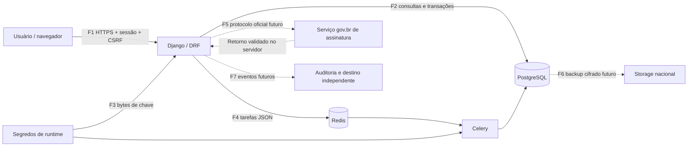

# Modelo de ameaças STRIDE — preparação do Lote 3

Data: 2026-11-03. Base revisada: v0.2.4, commit de main
`b90040fa9663e55d34b69130ef804f58fdba2c41`, CI concluído com sucesso.
Estado: análise técnica documentada; revisão externa pendente. Não é RIPD,
parecer jurídico, pentest nem declaração de conformidade.

## Escopo e premissas

Sistema single-tenant para prontuário infantil, atualmente sem dados reais e sem
produção. Abrange autenticação, autorização da API, dados cifrados, PostgreSQL,
fila Redis/Celery e os futuros Registro, retificação, adendo e assinatura gov.br.
Portal, uploads, teleatendimento e auditoria completa permanecem nos lotes previstos;
suas interfaces futuras são consideradas apenas onde afetam o Lote 3.

Preservam-se as decisões: login por username, autoria indelegável, retificação
como novo registro da mesma categoria, adendo distinto de retificação, resumo
compartilhado e detalhes privados por categoria. Gov.br é obrigatório no v0.
TOTP autentica; não substitui assinatura eletrônica avançada ou qualificada.

A análise distingue código observado, falha reproduzida e controle proposto.
Um controle proposto só poderá ser marcado como testado após implementação e
verificação correspondente. Nenhum ambiente de desenvolvimento é configuração
de produção.

## Ativos e agentes

| Ativo | Dano principal |
|---|---|
| Identificação, vínculos de guarda e contatos | Exposição, associação à criança errada ou perda de acesso legítimo |
| Registros, conteúdo privado e resumo compartilhado | Quebra de sigilo, adulteração ou atribuição falsa |
| Identidade e registro profissional | Uso indevido de autoria e assinatura |
| Chaves A/B/C/E/F, chave de backup D e credenciais | Leitura de dados, impersonação ou perda irrecuperável |
| Evidências de consentimento e assinatura | Aceite falso, repúdio e inconsistência histórica |
| Logs, banco e backups | Apagamento de evidências e indisponibilidade |

Agentes: profissional, administração, suporte TI, futuro responsável no portal,
usuário externo, conta comprometida e operador de infraestrutura. Um usuário
autenticado também pode abusar de permissões. Comprometimento do host/root ou do
administrador PostgreSQL ultrapassa a proteção oferecida apenas pela aplicação.

## Fluxos e fronteiras de confiança

F1: cliente não define identidade, privilégios ou autoria. F2: a conexão da
aplicação não deve administrar o banco em produção. F3: segredo não é dado de
payload nem variável exibida em logs. F4: rede interna não torna mensagens
automaticamente confiáveis. F5: retorno do navegador não comprova assinatura.
F6: restauração exige dados e chaves recuperáveis. F7: logs não podem conter
conteúdo clínico em claro nem depender exclusivamente do mesmo administrador.
Linhas pontilhadas representam controles/integrações ainda não implementados.

## Critério de risco

Probabilidade e impacto: 1 baixo, 2 médio, 3 alto. Produto: 1–2 baixo, 3–4 médio,
6 alto, 9 crítico. Escala qualitativa para ordenar trabalho, sem alegar frequência
estatística. Risco inerente considera a arquitetura atual ou o fluxo futuro sem
o controle proposto. Risco residual não foi pontuado sem testes de eficácia.

S = falsificação de identidade; T = adulteração; R = repúdio;
I = divulgação; D = indisponibilidade; E = elevação de privilégio.

| ID / classe | Cenário e fronteira | P×I | Estado e evidência | Tratamento e verificação exigida |
|---|---|---|---|---|
| TH01 S/E | Conta comprometida acessa dados sem segundo fator efetivo, F1 | 3×3 crítico | Campos TOTP e bloqueio existem em Usuario; autenticação da API usa sessão, sem fluxo MFA efetivo observado | Implementar MFA, limitação de tentativas e recuperação controlada antes de dados reais; testar bypass, sessão e recuperação |
| TH02 T/E | Profissional transfere responsável para paciente fora da equipe, F1/F2 | 3×3 crítico | Reproduzido na v0.2.4: PATCH retorna 200 e altera paciente_id; correção acompanha esta análise | Tornar paciente imutável na atualização pela API; testar admin, profissional com/sem acesso ao destino e atualização legítima; nenhuma linha deve mudar no pedido rejeitado |
| TH03 T/E | Profissional altera guarda, identificação ou estado legal sem competência, F1 | 2×3 alto | Serializers expõem campos editáveis; restrições por campo ainda pendentes no ADR-011 | Definir e aplicar matriz por campo, incluindo PUT/PATCH; guarda apenas pelo fluxo administrativo; testar cada perfil e tentativa de atribuição em massa |
| TH04 I/E | TI lê prontuário rotineiramente por ser tratado como admin, F1/F2 | 2×3 alto | Usuario.eh_admin inclui TI; já reconhecido no ADR-011 | Separação TI/admin e acesso emergencial justificado, temporário e auditado antes de produção; não alegar isolamento enquanto isso não existir |
| TH05 T/R | Cliente atribui registro a outro autor ou altera autoria por SQL, F1/F2 | 2×3 alto | Registro e trigger ainda não implementados | Autor definido no servidor pela identidade autenticada; sem escrita pelo cliente; trigger PG para imutabilidade e testes com SQL direto sob role runtime |
| TH06 T/R | Conteúdo muda depois da assinatura, mas mantém a evidência anterior, F2/F5 | 2×3 alto | Registro e Assinatura futuros | Congelar payload assinado e seu identificador de versão; verificar digest e evidência no servidor; impedir UPDATE/DELETE do conteúdo selado inclusive por SQL da role runtime |
| TH07 S/T/R | Assinante divergente do autor, callback forjado ou reaproveitado, F1/F5 | 2×3 alto | Integração não implementada; credenciais e contrato técnico do provedor não confirmados | Usar protocolo oficial e proteção antirreplay adequada; correlacionar solicitação, documento, autor e evidência; não marcar assinado por flag do cliente; testar repetição, identidade divergente e conteúdo trocado |
| TH08 I/E | Resumo compartilha detalhe privado ou profissional de outra categoria recebe o texto completo, F1/F2/F4 | 2×3 alto | Registro ainda não implementado; vínculo atual de equipe não estabelece privacidade por categoria | Filtrar queryset e campos de resposta por categoria, vínculo ativo e compartilhamento explícito; testar lista, detalhe, exportação e tarefas; ocultar só no frontend não serve |
| TH09 T/R | Retificação cruza pacientes/categorias, muda original ou cria ciclo, F1/F2 | 2×3 alto | Regras no ADR-004, sem modelo | Novo registro, mesmo paciente e categoria, autoria própria, justificativa do ADR-004; adendo separado sem justificativa obrigatória; testar árvore, original preservado e vínculos inválidos |
| TH10 T/R/D | Requisições concorrentes duplicam versão de consentimento ou número de prontuário, F2 | 2×2 médio | Consentimento calcula última versão + 1 sem constraint de unicidade; paciente calcula sequência antes de salvar | Transação/lock ou sequência segura e constraint correspondente; testes concorrentes em PG real, sem aceitar dois sucessos com mesma versão e sem 500 como resposta funcional |
| TH11 I/T | Conteúdo decifrado aparece em JSON, logs, mensagens ou erros; injeção de HTML no futuro frontend, F1/F4/F7 | 2×3 alto | Fields decifram ao ler do banco; sufixo _cifrado não protege resposta; __str__ de Paciente inclui nome | Revisar campos e minimização, remover conteúdo clínico de logs e filas; renderizar texto com escape; testar ausência de segredos e detalhes privados em respostas/erros e logs |
| TH12 T/R | Operador privilegiado altera log, desliga trigger ou recalcula cadeia, F2/F7 | 2×3 alto | Auditoria completa futura; ADR-003 exagera alcance de trigger contra owner/superuser | Separar owner de migrations e role runtime; evidência independente e verificação da cadeia; testar proibições com role correta; documentar limite contra root/superuser |
| TH13 D/T | Falha do provedor, timeout ou retry cria assinatura falsa/duplicada, F4/F5 | 2×2 médio | Fluxo futuro | Máquina de estados e idempotência; retries limitados; não manter lock de banco durante chamada externa; indisponibilidade mantém pendente/falhou, nunca assinado; TOTP não é fallback de assinatura |
| TH14 I/E/T | Credencial do Redis permite injetar tarefa ou obter resultado sensível, F4 | 2×3 alto | Compose mantém Redis interno; serialização aceita apenas JSON; worker compartilha capacidade de acesso a banco e chaves | Rede/credenciais por ambiente e tarefa com IDs mínimos; reavaliar autorização na execução; não aceitar payload de código nem tratar JSON como autorização; testar tarefa após revogação do vínculo |
| TH15 D/I | Perda de chave, backup incompleto ou restauração incompatível, F3/F6 | 2×3 alto | Leitura binária e dependências testadas; operação de backup/restore ainda futura | Restauração completa com versão do código e chaves correspondentes, cópia nacional cifrada e ensaio; rotação F recompõe índices HMAC sem imprimir CPF/chaves |
| TH16 D/E | Payload excessivo, brute force ou dependência/imagem vulnerável, F1/F4 | 2×2 médio | Lock com hashes e auditoria bloqueante implementados; sem rate limiting efetivo; imagens usam tags mutáveis | Manter auditoria de dependências; estabelecer limites de corpo/tempo/fila e autenticação; revisar imagens/OS também; auditoria pip não verifica pacotes do sistema ou infraestrutura |

## Pontos que a arquitetura precisa respeitar

1. **Integridade histórica:** autor e categoria no momento da autoria não podem
   depender de alteração posterior no cadastro do profissional. Usar evidência ou
   snapshot histórico imutável e definir a política antes das migrations de Registro.
2. **Assinatura:** autenticação gov.br e assinatura gov.br são fluxos distintos.
   O desenho precisa confirmar produto, acesso, protocolo e verificabilidade com
   a documentação oficial vigente. Não inventar endpoint, certificado ou evidência,
   nem apresentar um adaptador simulado como integração concluída.
3. **Transações:** criação, vínculos e selagem precisam ter invariantes no banco;
   validar no serializer não protege SQL direto nem corridas concorrentes.
4. **Privilégio:** trigger não é barreira contra superuser ou owner que pode removê-lo.
   A role criada pelo POSTGRES_USER do Compose é de desenvolvimento e não comprova
   restrições de produção. Ajuste necessário ao alcance descrito no ADR-003, sem
   abandonar a decisão de append-only.
5. **Autorização:** vínculo ativo não autoriza qualquer campo, categoria ou ação.
   Acesso de administrador ao cadastro também não autoriza autoria/assinatura clínica.
6. **Consentimento:** declaração enviada por um usuário não comprova identidade do
   responsável ou aceite. O futuro fluxo de captura precisa registrar evidência e
   timestamps do servidor; Model.clean não é executado automaticamente por save/DRF.

## Ordem de execução e critérios de saída

| Marco | Critério verificável | Situação nesta análise |
|---|---|---|
| Base técnica | Dependências corrigidas, CI bloqueante, chaves e Compose validados | Implementado/testado na v0.2.4; CI de main passou |
| Correção TH02 | Regressão falha na base e passa após bloqueio; atualização legítima preservada | Correção e testes acompanham este documento |
| Autorização antes de Registro | Matriz de campos e categoria aplicada; acesso ao destino e ações revisados | Pendente; próxima frente recomendada |
| Desenho de Registro | Invariantes de autoria, conteúdo selado, retificação/adendo e categoria histórica definidos | Requisitos acima documentados; implementação pendente |
| Evidência PG | Testes de concorrência/SQL sob role runtime, incluindo tentativas de alteração direta | Pendente |
| Integração gov.br | Acesso técnico obtido, fluxo real e validação de evidência testados | Dependência externa pendente; não bloqueia o desenho local |
| Entrada de dados reais | MFA, isolamento de privilégios, logs, restauração, cerimônia e requisitos jurídicos/operacionais cumpridos | Pendente; fora da aprovação deste documento |

Não há autorização para dados reais por este relatório. MFA, TI/break-glass e
auditoria completa mantêm os marcos do projeto, mas são impedimentos de produção.
Os demais riscos não foram aceitos como resolvidos pelo simples registro no backlog.

## Evidências e manutenção

- Revisão de models, serializers, views, permissões, settings, Compose e ADRs 003,
  004 e 011. Relatórios anteriores em `docs/validacao/`.
- TH02 reproduzido com SQLite em memória e dados de factories dentro de container;
  nenhum dado real foi consultado ou alterado. Regressão em
  `backend/apps/clinica/tests/test_responsavel_vinculo.py`.
- Atualizar este modelo quando mudarem papéis, exposição de rede, categorias,
  formato assinado, integração gov.br, portal ou filas. A cada alteração, vincular
  ameaça, controle e teste em PR; revisão técnica pela responsável pelo projeto.
- Matriz jurídica CFP/COFFITO e adequação dos artefatos de assinatura continuam
  dependentes de validação especializada; este documento não as substitui.
